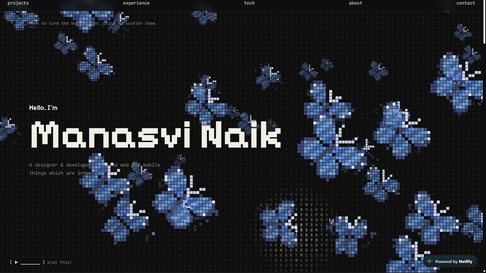
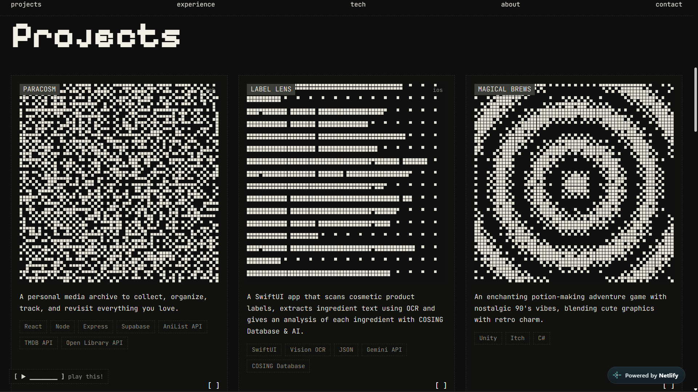
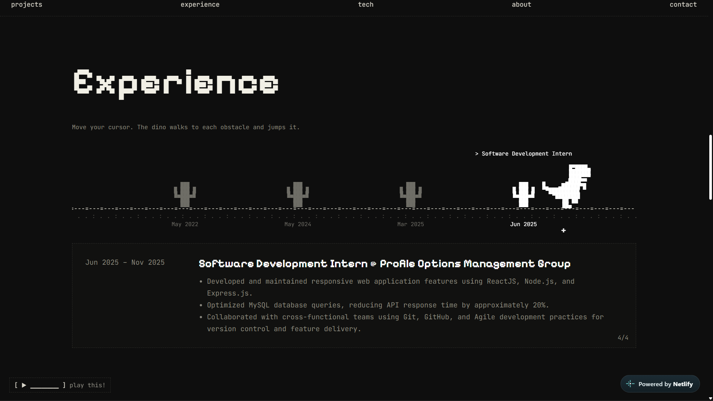
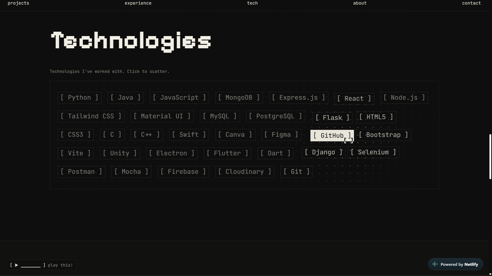
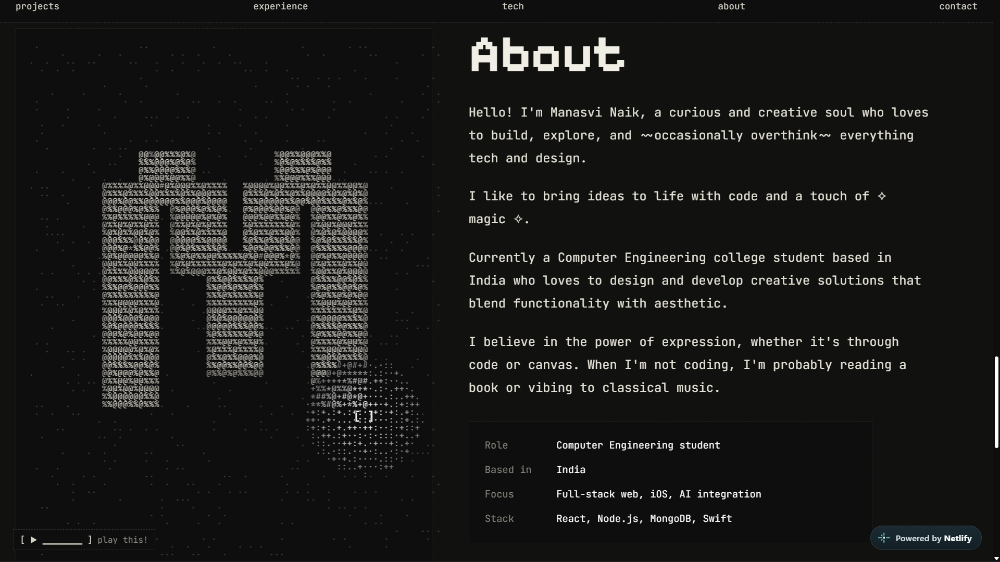
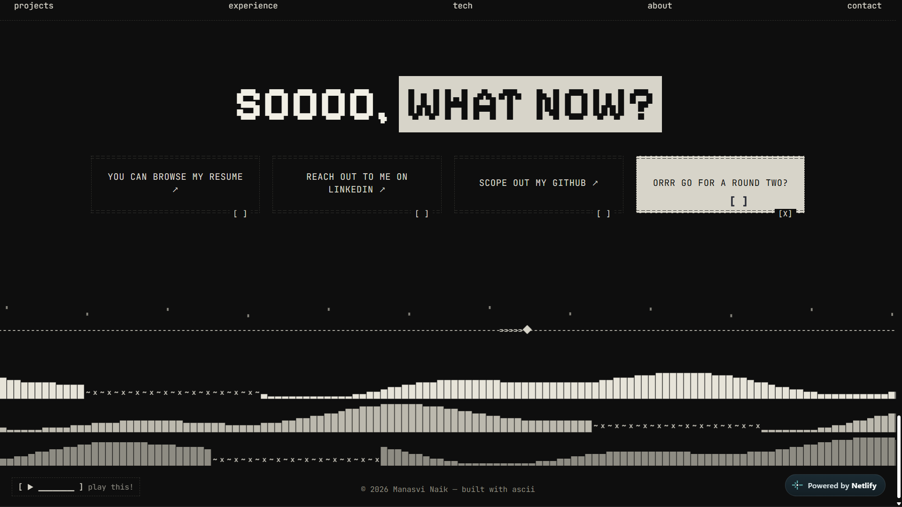

<table>
<tr>
<td>
<pre>
 __  __          _   _           _______      _______   _   _          _____ _  __
|  \/  |   /\   | \ | |   /\    / ____\ \    / /_   _| | \ | |   /\   |_   _| |/ /
| \  / |  /  \  |  \| |  /  \  | (___  \ \  / /  | |   |  \| |  /  \    | | | ' /
| |\/| | / /\ \ | . ` | / /\ \  \___ \  \ \/ /   | |   | . ` | / /\ \   | | |  <
| |  | |/ ____ \| |\  |/ ____ \ ____) |  \  /   _| |_  | |\  |/ ____ \ _| |_| . \
|_|  |_/_/    \_\_| \_/_/    \_\_____/    \/   |_____| |_| \_/_/    \_\_____|_|\_\
                          p o r t f o l i o   //   2026
</pre>
</td>
</tr>
</table>

**A dark, pixel-font personal portfolio, built from text.**
ASCII art, letter-scramble animations, dithered textures and a dinosaur who jumps over my work history.

## ▌ About

Hi, I'm **Manasvi Naik**, a Computer Engineering student in India who likes to build, explore and design.
This site is my corner of the internet: part portfolio, part experiment.

<table>
<tr>
<td>
<pre>
 ,-----.          ,--.,--.                   ,--.           ,--.   ,--.               ,--.
'  .--./ ,---.  ,-|  |`--',--,--,  ,---.     `--' ,---.     |   `.'   | ,--,--. ,---. `--' ,---.
|  |    | .-. |' .-. |,--.|      \| .-. |    ,--.(  .-'     |  |'.'|  |' ,-.  || .-. |,--.| .--'
'  '--'\' '-' '\ `-' ||  ||  ||  |' '-' '    |  |.-'  `)    |  |   |  |\ '-'  |' '-' '|  |\ `--.
 `-----' `---'  `---' `--'`--''--'.`-  /     `--'`----'     `--'   `--' `--`--'.`-  / `--' `---'
                                  `---'                                        `---'
</pre>
</td>
</tr>
</table>

## ▌ Screenshots

<table>
<tr>
<td width="50%"> <b>S1</b> · Hero</td>
<td width="50%"> <b>S2</b> · Projects</td>
</tr>
<tr>
<td width="50%"> <b>S3</b> · Experience timeline</td>
<td width="50%"> <b>S4</b> · Technologies</td>
</tr>
<tr>
<td width="50%"> <b>S5</b> · About</td>
<td width="50%"> <b>S6</b> · Contact</td>
</tr>
</table>

<table>
<tr>
<td>
<pre>
 ▄   ▄       ▄   ▄       ▄   ▄
▀▄█▄█▀▄     ▀▄█▄█▀▄     ▀▄█▄█▀▄      thanks for stopping by
  ▀█▀         ▀█▀         ▀█▀
</pre>
</td>
</tr>
</table>

© Manasvi Naik · built from text

